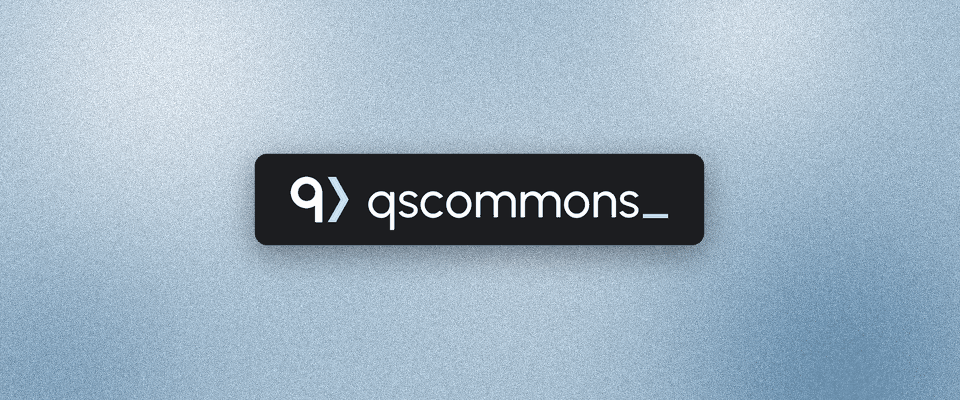

# qscommons

[qscommons](https://qscommons.org) is a home for open quantum work. It starts with software, and is built to hold learning sites, hardware development guides and research too.

Every project is held to the same standard:

- **Open**: MIT licensed, for teaching, research and commercial work.
- **Easy to start**: one command to install, or one link to read.
- **Checked against a reference**: results are compared with an independent implementation.
- **Reproducible**: documentation shows real output you can get yourself.

## Projects

| Project | What it is | Status |
| --- | --- | --- |
| [qscommons.org](https://qscommons.org) | qscommons.org live site | Live |
| [qsengine](https://github.com/qscommons/qsengine) | A state-vector quantum circuit simulator for Python, on any CPU or GPU | Stable |
| [qsengine-site](https://github.com/qscommons/qsengine-site) | qsengine's documentation site | Live |

## Get involved

Bug reports, examples, docs fixes and new ideas are all welcome. Everything is reviewed in public.

- Browse the [repositories](https://github.com/qscommons) and their open issues.
- Want to propose a new project (a tool, a learning site, a hardware guide or research)? Open an issue here that says what it is and who it is for.

## Licence

Projects are released under the MIT licence; see each repository's `LICENSE`.

Maintained by [kaiwave](https://github.com/kaiwave).
